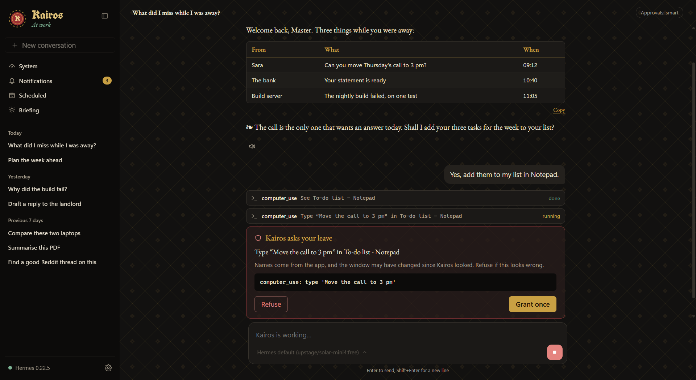
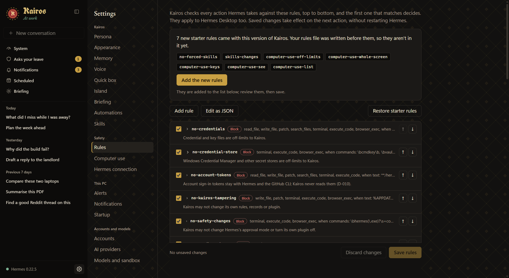
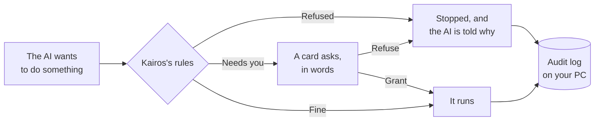
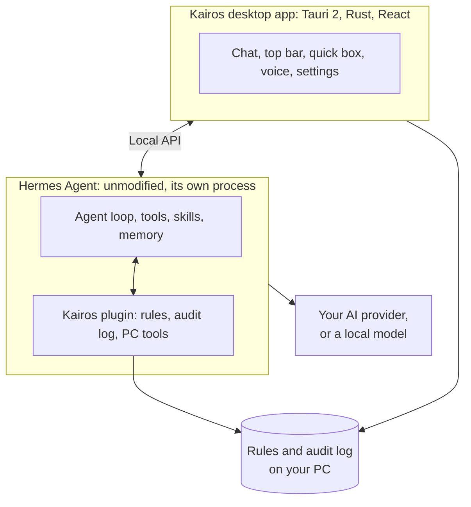

<p align="center">
  
</p>

<h1 align="center">Kairos</h1>

<p align="center">
  <strong>A steward for your Windows PC. It does the work, and it asks your leave first.</strong>
</p>

<p align="center">
  <em>καιρός: the right, opportune moment.</em>
</p>

<p align="center">
  
  
  
  
  
</p>

<p align="center">
  <picture>
    <source media="(prefers-color-scheme: light)" srcset="docs/images/kairos-light.png">
    
  </picture>
  <br>
  <sub>Shown with made-up data.</sub>
</p>

Most AI assistants live in a browser tab: they can tell you what to do, and then you do it. An assistant that can
really act on your PC is useful and alarming in equal measure, because the same power that tidies your files could
delete them.

**Kairos is built around that problem.** It reads your notifications, opens your apps, drives your browser and
works inside your programs. Between the AI and your PC stand rules that you can read and edit, a card that says
what's about to happen, and a log of everything it did. The model doesn't get a vote on any of them.

## A day with Kairos

| | |
|---|---|
| **You sit down** | A briefing is waiting: what you missed, and what actually wants an answer |
| **You're mid-task in another app** | Press Ctrl+Alt+K, ask, get the answer over whatever you're doing |
| **Your hands are full** | Hold a key and speak. Speech recognition and its voice both run on your PC, and nothing listens unless you hold the key |
| **A program crashes** | Kairos notices and offers to work out why |
| **You want it done, not explained** | It works in the app in the background, without taking your mouse or keyboard, and asks before each step |
| **It's about to pay for something** | It stops and asks |
| **You want to know what it did last Tuesday** | Every decision and every tool call is in the log on your PC |

## What makes it different

**It asks in words, not code.** A card reads *"Type 'Move the call to 3 pm' in To-do list - Notepad"*, not a raw
command. Typing is granted one line at a time, and nothing on your desktop can ever be granted for good.

**It keeps its hands off what matters.** Kairos can't click its own approval buttons, type into a terminal, or
open your password manager or bank. Those rules run before the AI's action does, outside the AI's control.

**Your AI, your choice.** Use Hermes's providers, your own API keys, any OpenAI-compatible endpoint, GitHub
Copilot, or a model running on your own PC with Ollama or LM Studio. Switch per conversation, and set a cost cap.

**It has a character.** Kairos is a steward from an illuminated charter: gold leaf for what it offers, crimson for
what it refuses, blackletter for its name. *"What is your will?"* The persona is yours to change, and so are the
themes.

## Everything it does

<table>
<tr>
<td width="50%" valign="top">

### Talk to it
- Streaming chat with tables, diagrams and images
- **Quick box** over any app (Ctrl+Alt+K)
- **Ctrl+K** palette and search across conversations
- **Push-to-talk voice**, with local Whisper and Kokoro
- **Welcome-back briefing**
- A **persona** of its own
- **Memory** you can see and undo

</td>
<td width="50%" valign="top">

### Use your PC
- **Computer use**: works inside your apps in the background (off by default)
- Opens and closes apps, and captures the screen when you allow it
- **Top bar** in the style of Omarchy: desktops, volume, battery, its own Wi-Fi and Bluetooth menus
- **Panel** with wallpaper, media, open and pinned apps
- **Clipboard shelf** at the edge of the screen
- **Themes** and patterns, dark and light

</td>
</tr>
<tr>
<td valign="top">

### Keep watch
- **Notifications** in one place, including calls and texts through Phone Link
- **System dashboard** and alerts
- **Automations** on events: a crash, the charger unplugged, logging in
- **Scheduled jobs**
- **Usage charts**: tokens, cost and models over time

</td>
<td valign="top">

### Reach further
- **Browser control** that stops before paying or sending
- **Google and GitHub** through their official sign-in, read-only by default
- **Skills** from Hermes's registries: read one and see its security scan before installing
- **MCP server manager**: add outside tools from Settings
- **Any model**, cloud or local

</td>
</tr>
</table>

## How it stays safe

<p align="center">
  
</p>

Every action the AI takes goes through this:



- **Rules you own.** Read and edit them in the app, or as a file. If they can't be read, everything is refused.
- **A record.** The audit log stays on your PC, and shows who decided what.
- **A container**, if you want one: commands can run in Docker, with only the folders you choose.
- **Keys out of reach.** The AI can't read credential files, and Kairos's own key is in the Windows credential store.

**No safety layer is perfect, and Kairos doesn't pretend otherwise.** Text on a page or in a window can carry
instructions to the AI, which is why every action asks and why it's worth reading the cards. What you ask, and what
it sees, goes to the AI provider you choose, unless you use a local model. Read more in
[docs/SECURITY.md](docs/SECURITY.md).

## How it's built

Kairos doesn't fork its engine. [Hermes Agent](https://github.com/NousResearch/hermes-agent) by Nous Research runs
unmodified as its own process and does the thinking, tools, skills and memory. Kairos adds the interface, and a plugin
that checks every tool call.



The test suite runs against **real recorded Hermes responses**, not guesses about them. Each decision is written
down with its alternatives in [docs/DECISIONS.md](docs/DECISIONS.md).

## Getting started

> **Pre-release.** There's no installer yet, and not everything has been signed off on a real PC:
> [docs/TESTING.md](docs/TESTING.md) lists what's left. Built against Hermes Agent 0.22.5.

You need Windows 11, [Hermes Agent](https://github.com/NousResearch/hermes-agent), Node with
[pnpm](https://pnpm.io), and Rust. Voice also needs Visual Studio Build Tools 2022, CMake and LLVM, at the paths in
[.cargo/config.toml](.cargo/config.toml). Docker Desktop is optional.

```powershell
# Make Hermes's API ready for Kairos
powershell -NoProfile -ExecutionPolicy Bypass -File scripts/setup.ps1

# Install the Kairos plugin into Hermes (asks first)
powershell -NoProfile -ExecutionPolicy Bypass -File scripts/install-plugin.ps1

# Install the app's dependencies, then run it
pnpm -C app install
pnpm -C app tauri dev
```

## Contributing and development

| What | Command |
|---|---|
| Rust tests | `cargo test --manifest-path app/src-tauri/Cargo.toml` |
| TypeScript tests | `pnpm -C app test` |
| Lint | `cargo clippy --manifest-path app/src-tauri/Cargo.toml -- -D warnings` and `pnpm -C app lint` |
| Plugin tests | `& (Get-Item "$env:LOCALAPPDATA\hermes\tools\python-*\python.exe")[0] -I -m unittest discover -s plugin/tests -t plugin` |

While the dev app runs, set `CARGO_TARGET_DIR=target/test-build` for Rust tests: Windows locks the running
`kairos.exe`. Work goes milestone by milestone, one branch each, stacked on the one before, so the newest work is on
the latest `m*/` branch.

<details>
<summary><strong>The repository</strong></summary>

```
Kairos/
├── app/        Desktop app: React and TypeScript, with the Rust core in src-tauri/
├── plugin/     Hermes plugin (Python, standard library only): rules, audit log, PC tools
├── skills/     Kairos's own Hermes skills
├── fixtures/   Recorded Hermes responses, the test suite's truth about Hermes
├── eval/       Evaluation tasks
├── scripts/    Setup and install scripts
└── docs/       Architecture, decisions, security, milestones
```

| Document | What it covers |
|---|---|
| [docs/ARCHITECTURE.md](docs/ARCHITECTURE.md) | Components, how Kairos talks to Hermes, who owns what data |
| [docs/DECISIONS.md](docs/DECISIONS.md) | Each design decision, with alternatives and reasons |
| [docs/SECURITY.md](docs/SECURITY.md) | Safety layers, rules, isolation, secrets, prompt injection |
| [docs/design/BRAND.md](docs/design/BRAND.md) | The illuminated charter: colour, type, words |
| [docs/ROADMAP.md](docs/ROADMAP.md) | The original milestones and their acceptance criteria |
| [docs/TESTING.md](docs/TESTING.md) | What's still to verify on a real PC |
| [docs/milestones/](docs/milestones/) | Each milestone's spec and acceptance record |
| [docs/plans/](docs/plans/) | Plans, including what comes next |

</details>

## Credits

Built on [Hermes Agent](https://github.com/NousResearch/hermes-agent), © 2025 Nous Research, MIT License. Computer
use goes through Hermes's use of [Cua Driver](https://github.com/trycua/cua). Voice uses
[whisper.cpp](https://github.com/ggml-org/whisper.cpp) and [Kokoro](https://github.com/hexgrad/kokoro).
