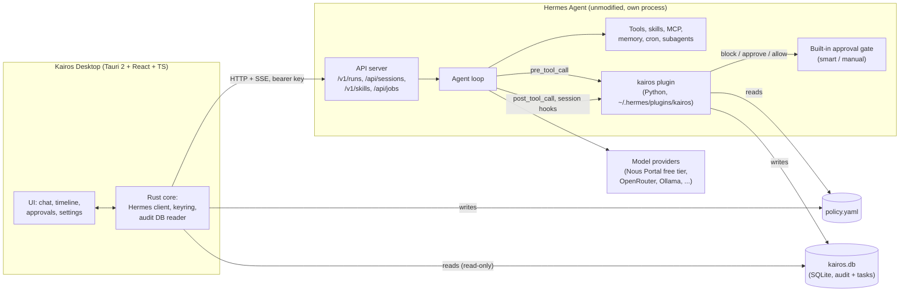
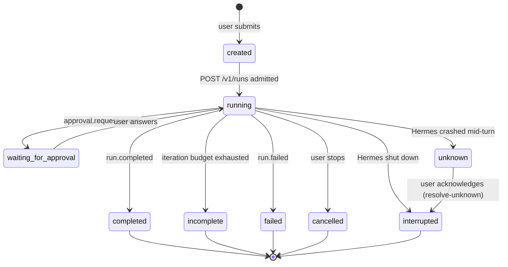

# Kairos Architecture

Status: Phase 0 draft, awaiting product-owner approval.
Hermes baseline: Hermes Agent 0.22.5 (commit `bf0203a`), MIT license.

## 1. What Kairos is

Kairos is a personal AI assistant. It does **not** implement its own agent loop. It runs
[Hermes Agent](https://github.com/NousResearch/hermes-agent) unmodified as its engine and adds
three things Hermes doesn't have:

1. **Its own desktop app**: chat, task timeline, approvals, settings, and later voice and an
   avatar.
2. **Its own policy layer**: Kairos-specific rules for what the agent may do, enforced inside
   Hermes through a plugin hook.
3. **Its own record of work**: an audit log and task history that Kairos owns, independent of
   Hermes's internal state.

Everything else — model providers, tools, skills, memory, subagents, scheduled jobs,
checkpoints, context compression — comes from Hermes.

### Non-goals for now

- Forking or patching Hermes core. Plugins must never edit Hermes files (this is also Hermes's own
  rule for plugins, `plugins/AGENTS.md`).
- Reimplementing anything Hermes already does well (see the reuse table in `DECISIONS.md`, D-001).
- Voice, avatar and proactive behaviour before the core loop is reliable (`ROADMAP.md`).

## 2. Components



| Component | Language | Owns | Talks to |
|---|---|---|---|
| **Kairos Desktop** | TypeScript (React) + Rust (Tauri) | All UI; the user's view of tasks and approvals; editing `policy.yaml` | Hermes API server; `kairos.db` read-only |
| **kairos plugin** | Python, runs inside Hermes | Policy decisions on every tool call; writing the audit log and task records | Hermes plugin `ctx`; `policy.yaml`; `kairos.db` |
| **Hermes Agent** | Python | Agent loop, providers, tools, skills, memory, approvals, scheduling | Model providers; the plugin through hooks |

There are exactly **two Kairos codebases** (the app and the plugin) and **no Kairos server
process**. The plugin runs inside Hermes; the app talks to Hermes directly.

## 3. Integration contract with Hermes

Kairos depends only on Hermes's **documented** surfaces. Each is listed so an upgrade can be
checked against it.

### 3.1 HTTP: Hermes API server (default `127.0.0.1:8642`)

Enabled with `API_SERVER_ENABLED=true` and a strong `API_SERVER_KEY` (Hermes refuses to start
with a key shorter than 16 characters).

| Kairos need | Hermes endpoint |
|---|---|
| Feature detection on connect | `GET /v1/capabilities` |
| Start a request | `POST /v1/runs` with `Idempotency-Key` and `session_id` |
| Live progress (tokens, tool start/finish, subagents) | `GET /v1/runs/{id}/events` (SSE) |
| Reconnect after the app restarts | `GET /v1/runs/{id}` (status, `pending_controls`) |
| Answer an approval | `POST /v1/runs/{id}/approval` with `request_id`, `execution_generation`, `choice` |
| Answer a clarifying question | `POST /v1/runs/{id}/clarify` |
| Stop | `POST /v1/runs/{id}/stop` |
| Recover a run lost in a Hermes crash | `POST /v1/runs/{id}/resolve-unknown` |
| Conversation list and history | `/api/sessions`, `/api/sessions/{id}/messages` |
| Show available skills and tools | `GET /v1/skills`, `GET /v1/toolsets` |
| Scheduled work (later milestone) | `/api/jobs` |
| Model picker | `GET /api/model/options`; per-request `model` / `provider` |

Why `/v1/runs` and not `/v1/chat/completions`: Runs give a durable run ID, an event stream,
approvals, stop, and crash-safe idempotency. Those are exactly what the task timeline needs.

### 3.2 In-process: Hermes plugin hooks

The kairos plugin is a general Hermes plugin (`plugin.yaml` + `__init__.py` with
`register(ctx)`), installed in `$HERMES_HOME/plugins/kairos/`.

| Hook | Kairos use | Behaviour |
|---|---|---|
| `pre_tool_call` | **Policy enforcement.** Look up the tool call in `policy.yaml`. | Return `{"action": "block", "message": ...}` to refuse, `{"action": "approve"}` to send it to Hermes's human-approval gate, or nothing to let Hermes's own rules decide. Hermes fails closed if the callback raises or times out. |
| `post_tool_call` | Audit record: tool, redacted arguments, status, duration, error. | Observer only. |
| `on_session_start` / `on_session_end` | Open and close task records. | Observer only. |
| `pre_approval_request` / `post_approval_response` | Record who approved what, and when. | Observer only; cannot pre-answer. |
| `pre_verify` | Later: Kairos-specific completion checks. | Can keep the turn going. |

Precedence in Hermes: any plugin's `block` beats any `approve`. Kairos can only make Hermes
**stricter** than its own defaults, never looser, which is the property we want.

### 3.3 Versioning

- On connect, Kairos checks `/v1/capabilities` for every feature it needs (`run_submission`,
  `run_events_sse`, `run_stop`, `run_approval_response`, ...; full list in
  `docs/milestones/M1.md` §5) and refuses to start with a clear message if one is missing.
  Feature flags are the compatibility test.
- The running version comes from `GET /health` (`"version": "0.22.5"`); Kairos records the version
  it was tested against and warns on a different one.
- An upgrade of Hermes is a deliberate step: run Kairos's integration tests against it first.

## 4. Data ownership

| Data | Owner | Where |
|---|---|---|
| Conversations, messages, model memory, skills | Hermes | `$HERMES_HOME/state.db`, `memories/`, `skills/` |
| Secrets for model providers | Hermes | `$HERMES_HOME/.env` / Hermes credential vault |
| Hermes API key, as Kairos uses it | Kairos | OS keyring (Windows Credential Manager / libsecret) |
| Policy rules | Kairos | `$KAIROS_HOME/policy.yaml` |
| Audit log, task records | Kairos | `$KAIROS_HOME/kairos.db` (SQLite, WAL) |
| UI preferences | Kairos | Tauri app config dir |

Kairos never writes to Hermes's databases. It reads Hermes data only through the API.

### Initial `kairos.db` schema (milestone 1 only)

```sql
CREATE TABLE task (            -- one per Kairos request (= one Hermes run)
  id            TEXT PRIMARY KEY,   -- ULID, also used as the Idempotency-Key
  session_id    TEXT NOT NULL,      -- Hermes session
  run_id        TEXT,               -- Hermes run, set once admitted
  goal          TEXT NOT NULL,      -- the user's request
  status        TEXT NOT NULL,      -- see lifecycle below
  created_at    INTEGER NOT NULL,
  finished_at   INTEGER,
  outcome       TEXT                -- final summary or error
);

CREATE TABLE tool_event (      -- written by the plugin from pre/post_tool_call
  id            INTEGER PRIMARY KEY,
  session_id    TEXT NOT NULL,
  tool_call_id  TEXT NOT NULL,
  tool_name     TEXT NOT NULL,
  args_redacted TEXT NOT NULL,      -- JSON, secrets removed
  decision      TEXT NOT NULL,      -- allow | block | approve-requested
  rule_id       TEXT,               -- which policy rule matched
  status        TEXT,               -- ok | error | blocked | denied
  duration_ms   INTEGER,
  at            INTEGER NOT NULL
);

CREATE TABLE approval (
  id            INTEGER PRIMARY KEY,
  session_id    TEXT NOT NULL,
  request_id    TEXT NOT NULL,
  prompt        TEXT NOT NULL,      -- already redacted by Hermes
  choice        TEXT,               -- once | session | always | deny | timeout | ...
  surface       TEXT,
  requested_at  INTEGER NOT NULL,
  answered_at   INTEGER
);
```

Who writes what: the app writes `task`; the plugin writes `tool_event` and `approval`. Each
table has one writer, so there are no write conflicts across processes.

## 5. Task lifecycle

Kairos tracks Hermes runs; it does not run its own task engine in milestone 1.



**Duplicate-prevention after a crash** comes from Hermes's idempotency ledger: the app creates the
task ID before calling Hermes and sends it as `Idempotency-Key`. A retry with the same key never
starts a second run (it replays or returns a conflict). An `unknown` run is **never** resent under
a new key; the user is shown what is known and decides.

**"Attempted" vs "succeeded"** is shown separately in the UI: a `tool.completed` event with
`error: true`, or a `BLOCKED:` result, is displayed as a failure even if the model's final text
sounds positive.

## 6. A request, end to end

1. The user types a request. The app creates a `task` row (status `created`, ID = new ULID).
2. The app calls `POST /v1/runs` with `Idempotency-Key: <task id>` and the session ID, and stores
   the returned `run_id` (status `running`).
3. The app subscribes to `/v1/runs/{id}/events` and renders tokens and tool events live.
4. Hermes's agent decides to call `terminal`. Before it runs, Hermes calls the kairos plugin's
   `pre_tool_call`. The plugin matches `policy.yaml`:
   - a `deny` rule → returns `block`; the model sees the refusal; `tool_event.decision = block`.
   - an `ask` rule → returns `approve`; Hermes parks the run and emits `approval.request`.
   - no rule → returns nothing; Hermes's own approval mode decides.
5. On `approval.request` the app shows an approval card. The user's choice goes to
   `POST /v1/runs/{id}/approval`. The plugin records the answer via `post_approval_response`.
6. `post_tool_call` writes the result status and duration.
7. `run.completed` arrives. The app marks the task `completed` with the outcome, and the timeline
   shows every tool call with its decision and result, read from `kairos.db`.

## 7. Cross-platform notes

Hermes runs natively on Windows, macOS and Linux. Kairos targets **Windows 11 first**
(`DECISIONS.md`, D-008) and avoids OS-specific code outside the keyring, paths and setup scripts,
so Linux can follow. The **isolation** story differs per OS (`SECURITY.md` §4).
